## Table of Contents

<details>

   <summary>Contents</summary>

1. [Screenshots](#screenshots)
1. [Documentation](#documentation)
1. [Requirements](#requirements)
1. [Ecosystem](#ecosystem)

</details>

<p align="center">
  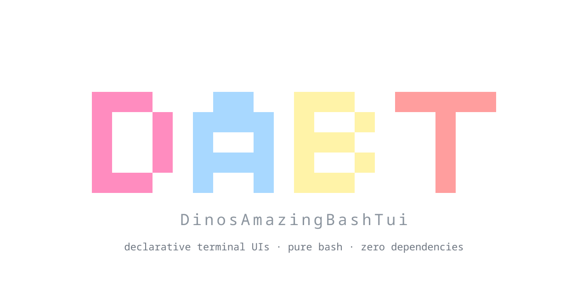

<br/>
<a href="https://github.com/DinosaursAreCute/DinosAmazingBashTui/stargazers"></a>
  <a href="https://github.com/DinosaursAreCute/DinosAmazingBashTui/releases"></a>
  <a href="https://github.com/DinosaursAreCute/DinosAmazingBashTui/releases"></a>
  <a href="https://github.com/DinosaursAreCute/DinosAmazingBashTui/commits/main"></a>
  <br/>
  
  
</p>

<p align="center">
  <b>Build terminal UIs in pure bash.</b><br/>
</p>

> **New in DevEx Update 4:** a Markdown renderer for bash, with tables, highlighted code, followable links and images in kitty and Ghostty. [Guide](docs/guide/markdown.md) · [Changelog](CHANGELOG.md)

<details open>
<summary><b>Contents</b></summary>

1. [Overview](#overview)
1. [Quick start](#quick-start)
1. [A TUI framework](#a-tui-framework)
1. [An application manager](#an-application-manager)
1. [Screenshots](#screenshots)
1. [Documentation](#documentation)
1. [Requirements](#requirements)
1. [Ecosystem](#ecosystem)

</details>
<h2 id="overview"></h2>

**D.A.B.T** *(DinosAmazingBashTui)* is two things in one:

- **A TUI framework.** You build terminal apps the way you build a website: markup for structure, a stylesheet for looks, bash functions for behavior. DABT takes care of layout, rendering, focus, mouse input and live processes.
- **An application manager.** The `dabt` command installs, updates, scans and removes apps built with the framework, and keeps itself up to date.

All of it runs on Bash 5 and standard POSIX utilities.

<h2 id="quick-start"></h2>


```bash
curl -fsSL https://raw.githubusercontent.com/DinosaursAreCute/DinosAmazingBashTui/main/install.sh | bash
dabt --demo
```

Want to look around before installing? Run the demo from a checkout:

```bash
git clone https://github.com/DinosaursAreCute/DinosAmazingBashTui.git
cd DinosAmazingBashTui && bin/dabt demo
```

<h2 id="a-tui-framework"></h2>

DABT aims to bring a desktop-like experience to terminal applications.

- **Pages in HTML-like XML**: panes, splits, grids, tabs, templates and components
- **Themes in CSS-like stylesheets**: 13 built-in, switchable at runtime
- **Full mouse and keyboard support**: rebindable keys and a searchable command palette
- **Rich widgets**: inputs, text areas with undo/redo, lists, tables, selects, dialogs and toasts
- **Live subprocesses**: stream any command into a pane through a real PTY, with stdin, cancel and retry
- **Extras**: a Markdown renderer, standalone terminal renderers (tables, gauges, trees, charts) and drop-in plugins

<details open>
<summary><b>Example: a small task app</b></summary>
<br/>

**`config/task_view.xml`** describes the page:

```xml
<tui on_visit="tasks_visit">
  <script src="home_callbacks.sh"/>
  <theme  src="theme.css"/>
  <footer items="@tui.action.quit"/>

  <pane id="root" split="v" border="none">
    <pane id="head" height="4" title="Tasks" border="single" class="panel" hpad="1">
      <label id="lbl_title" text="My tasks" class="brand"/>
      <label id="lbl_count" text=""         class="muted_label"/>
    </pane>
    <pane id="body" split="h" border="none">
      <pane id="add" width="38%" title="New task" border="single" class="panel" hpad="1">
        <input  id="inp_task"  label="Task:" label_width="7" placeholder="Enter Task Title" submit="on_add"/>
        <button id="btn_add"   text="[ Add ]"             action="on_add"    class="success_button" align="fill" row="2"/>
        <button id="btn_done"  text="[ Remove selected ]" action="on_remove" class="info_button"    align="fill" row="4"/>
        <button id="btn_clear" text="[ Clear all ]"       action="on_clear"  class="danger_button"  align="fill" row="5"/>
      </pane>
      <pane id="tasks" title="Your tasks" border="single" class="panel" hpad="1">
        <list id="lst_tasks"/>
      </pane>
    </pane>
  </pane>
</tui>
```

**`theme.css`** styles it:

```css
.panel               { fg: #d8dee9; bg: #2e3440; }
.panel:border        { fg: #4c566a; }
.brand               { fg: #88c0d0; mods: bold; }
.muted_label         { fg: #616e88; }
.success_button      { fg: #2e3440; bg: #a3be8c; }
.info_button         { fg: #2e3440; bg: #81a1c1; }
.danger_button       { fg: white;   bg: #b00020; mods: bold; }
.danger_button:focus { fg: white;   bg: #ff3333; mods: bold; }
```

**`app.sh`** starts it:

```bash
#!/usr/bin/env bash
source lib/tui.sh
tui.start "config/task_view.xml"
```

`on_add`, `on_remove` and `on_clear` are ordinary bash functions in `home_callbacks.sh`. The full walkthrough is in [Writing Your First App](docs/tutorials/writing-your-first-app.md).

</details>

<h2 id="an-application-manager"></h2>

The `dabt` command builds, publishes, installs and updates DABT apps.

- **Install from anywhere**: a local folder or a git URL
- **One-command updates** for your apps and for DABT itself
- **Security scanning** of every app and plugin before it installs
- **Package signing**: build, sign and verify `.dapk` packages
- **GitHub CLI integration** for publishing
- **Safe updates**: you see every changed file first, and your own edits are never overwritten silently

```bash
dabt app install https://github.com/DinosaursAreCute/DabtFileExplorer
dabt app list
dabt update
```

<details>
<summary><b>All commands</b></summary>
<br/>

| Command | What it does |
|---|---|
| `dabt --demo` | run the demo app |
| `dabt doctor` | installed version and where everything lives |
| `dabt update [--dev] [--check]` | update to the latest release (or to `main`) |
| `dabt app install SRC [--strict]` | install an app, scanned first |
| `dabt app list\|info\|run\|update\|remove` | manage installed apps |
| `dabt scan PATH [--deep] [--strict]` | security-scan scripts |
| `dabt scan --tools` | show the optional scanners |
| `dabt clear-cache` | delete the page cache |
| `dabt reinstall` / `uninstall` | reinstall or remove DABT |

Run `dabt --help` for every flag.

</details>

<details>
<summary><b>How the security scan works</b></summary>
<br/>

Apps and plugins are shell code that runs with your permissions, so DABT scans them before installing. A built-in scanner (pure bash and `grep`) flags the obvious red flags: piping downloads into a shell, reverse shells, `rm -rf /`, edits to `sudoers` or `authorized_keys`, embedded keys. If [ShellCheck](https://www.shellcheck.net) or [Semgrep](https://semgrep.dev) is installed, DABT uses it for a deeper look. Neither is ever required, and `dabt scan --install` asks before installing anything.

Findings only warn by default. `--strict` refuses to install on HIGH findings.

A text-pattern scan can be fooled, so **a clean report is not a guarantee.**

</details>

<h2 id="performance"></h2>

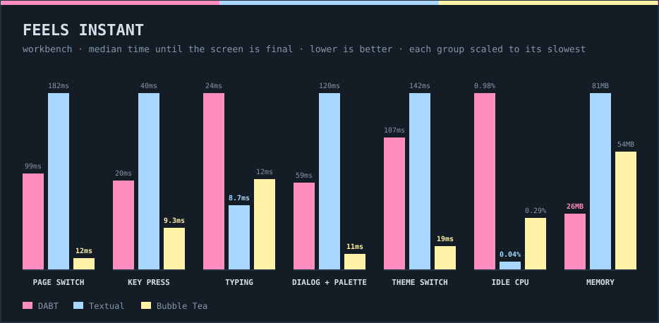
<br/>

One of the first questions that might come to mind: 
A bash tui framework that does all these things? That must be slowwwwwwwww! \
Behold with the power of one (1) slightly obsessed bash developer and a keyboard this is what dabt looks like compared to textual and bubbletea. 

A page switch lands in about 100 ms: \
well ahead of Textual :D \
a good mile behind bubbletea :( \
Memory is the lowest of the three. Idle CPU is not, and we are working on it. \
We will not beat Bubble Tea (or will we?), and the fact a shell script that gets within shouting distance of it is kinda funny.

Numbers are from one run of [`tools/compare-v2`](tools/compare-v2/README.md), so treat them as a mood, not a verdict. Re-run it on your own machine, or [read the harness](tools/compare-v2/) and tell us what we got wrong.

## Screenshots

| Default | Nord | Gruvbox |
|:---:|:---:|:---:|
| 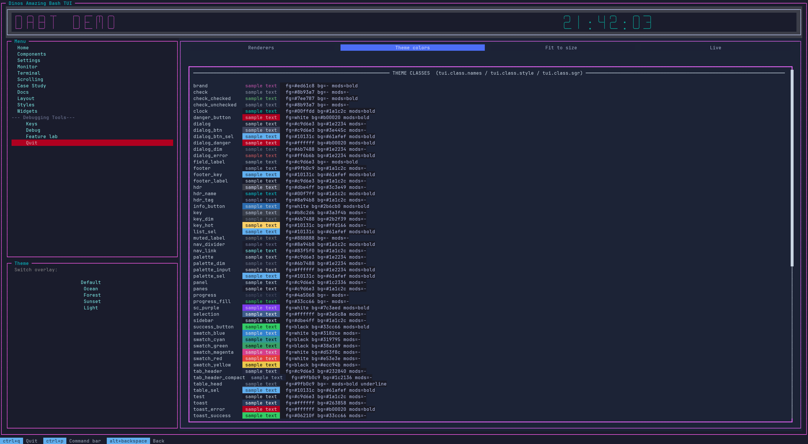 | 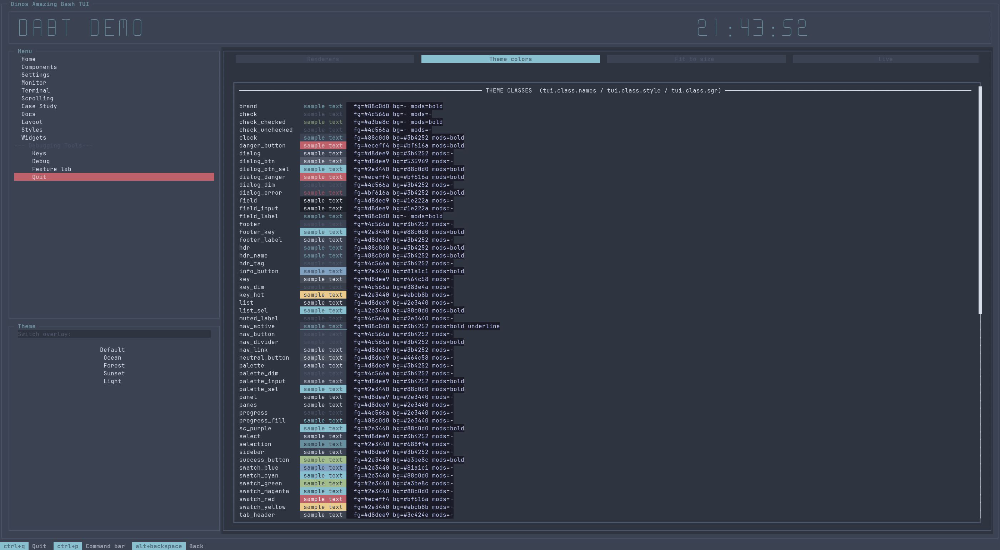 | 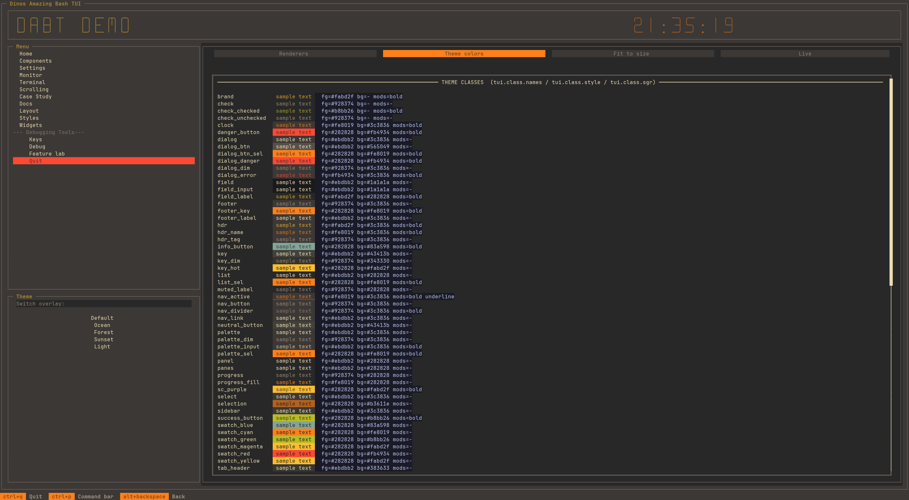 |

<details>
<summary><b>More pages and themes</b></summary>
<br/>

**Components**: every terminal renderer, with fit-to-pane and live tabs
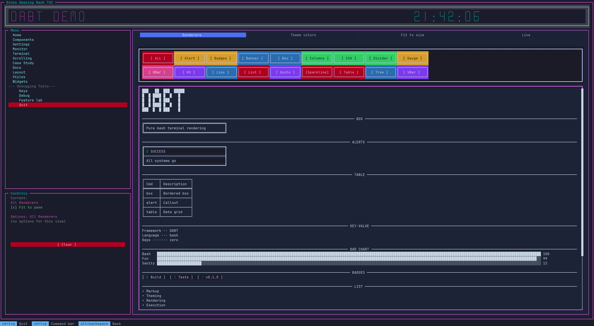

**Monitor**: live CPU, memory, load and disk straight from `/proc`
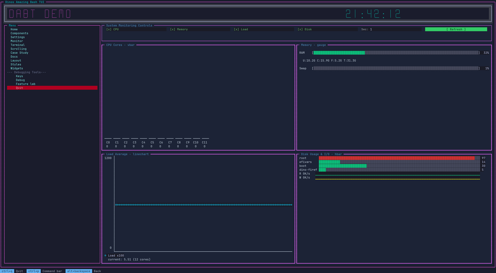

**Settings**

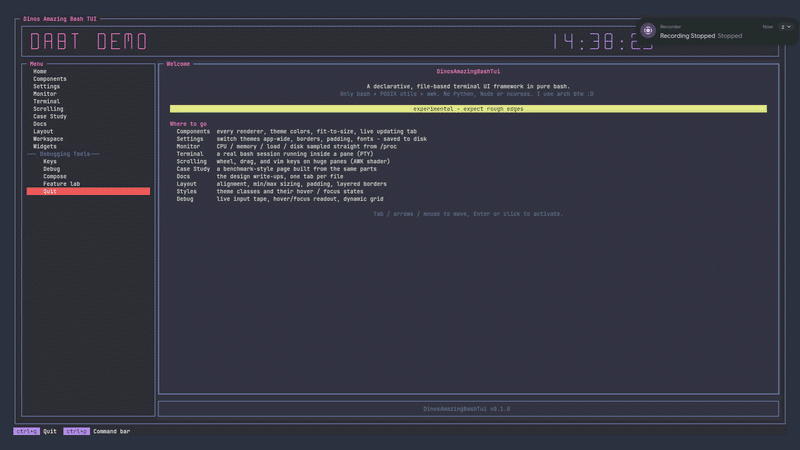

| Ocean | Forest | Sunset |
|:---:|:---:|:---:|
| 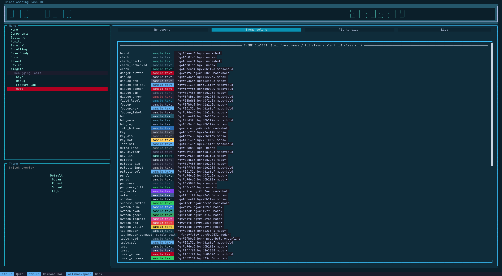 | 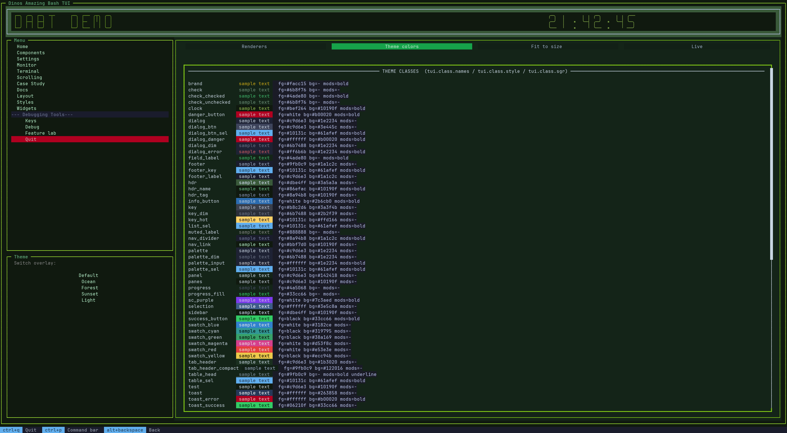 | 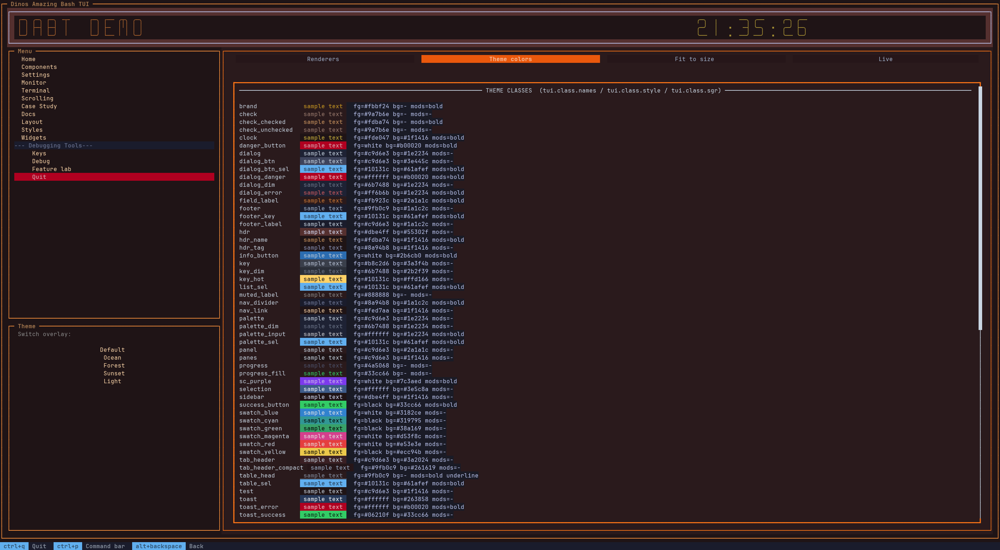 |

| Dracula | Solarized Dark | Light |
|:---:|:---:|:---:|
| 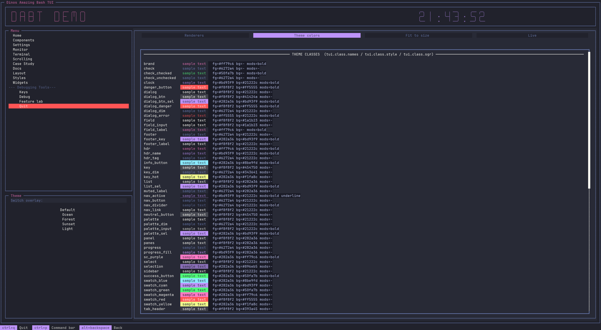 | 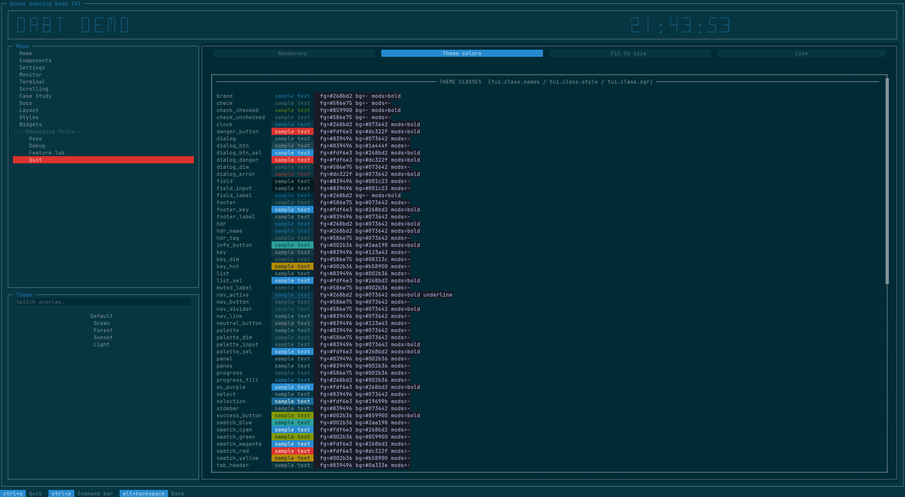 | 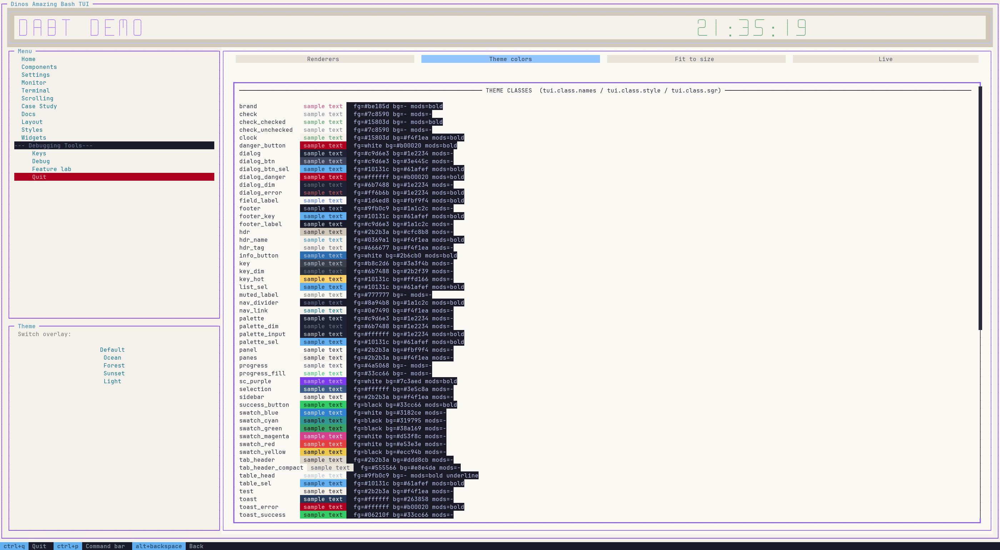 |

Any `.css` file in `share/defaults/themes/` shows up as a theme.

</details>

## Documentation

Browse the [documentation site](https://dinosamazingbashtui.duckdns.org/), or start here:

| | |
|---|---|
| [Writing Your First App](docs/tutorials/writing-your-first-app.md) | step-by-step, for beginners |
| [Writing Your First Plugin](docs/tutorials/writing-your-first-plugin.md) | commands, keys, timers, settings |
| [Markup](docs/guide/markup.md) | the XML page format |
| [Widgets](docs/guide/widgets.md) | inputs, lists, tables, text editing |
| [Debugging](docs/guide/debugging.md) | `dabt --debug`, the status strip, the dev-tools dock |
| [API reference](docs/api/reference.md) | every function in one table |
| [Install & update](docs/guide/install-and-update.md) | installer, config home, conflicts |

## Requirements

- **Bash 5.0+** (on macOS: `brew install bash`)
- **POSIX utilities** (`awk`, `sed`, `stty`, `find` ...)
- A terminal with mouse support

<details>
<summary><b>Optional tools</b></summary>
<br/>

Nothing below is needed to run an app. Each one unlocks or improves a single feature.

| Tool | Used for |
|---|---|
| `curl` or `wget`, `tar` | `dabt update` and installs from a URL |
| `git` | installing apps from a git URL |
| `script(1)` | a real PTY for live process panes (falls back to pipes) |
| `sha256sum`, `shasum` or `openssl` | checksums in the installer and updater |
| `shellcheck`, `semgrep` | deeper security scans |
| `bats` | the test suite |

The full list is in [docs/concepts/portability.md](docs/concepts/portability.md).

</details>

## Ecosystem

- **[DABT Tools](https://github.com/DinosaursAreCute/DinosAmazingDabtPlugin)**: a VS Code extension with completions, inlay hints and live theme color swatches for DABT markup.

---

Contributions are not open yet; they will be once the code, tests and docs are mature enough. Licensed under [MIT](LICENSE).

<p align="center"><sub>Just bash, doing things bash was never meant to do. · <i>I use arch btw :D</i></sub></p>
