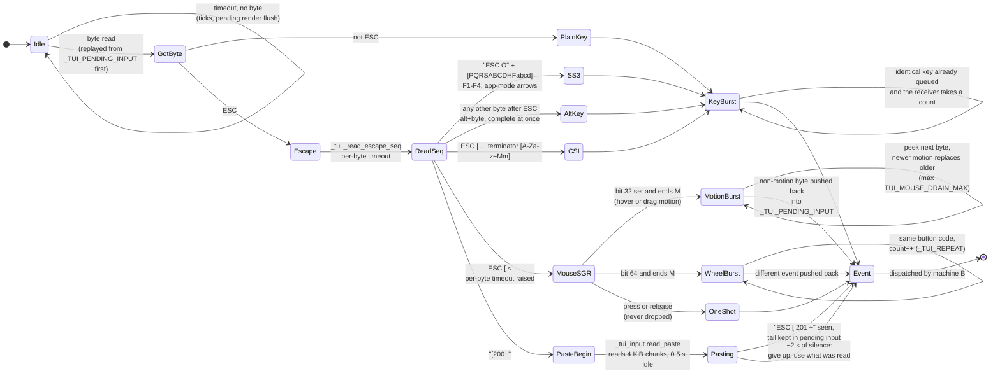
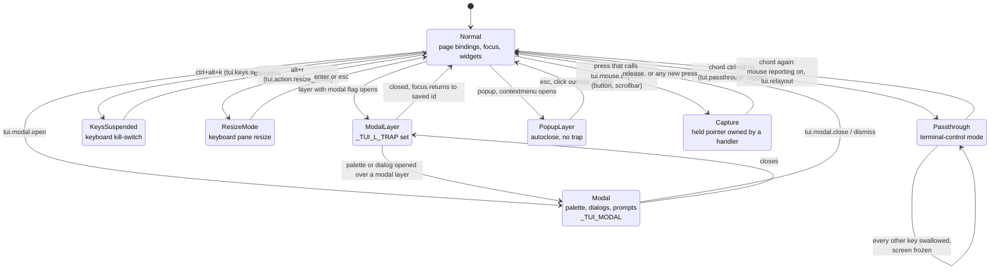
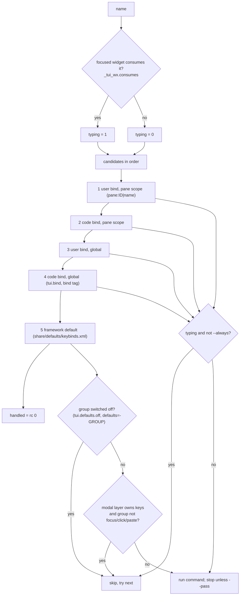
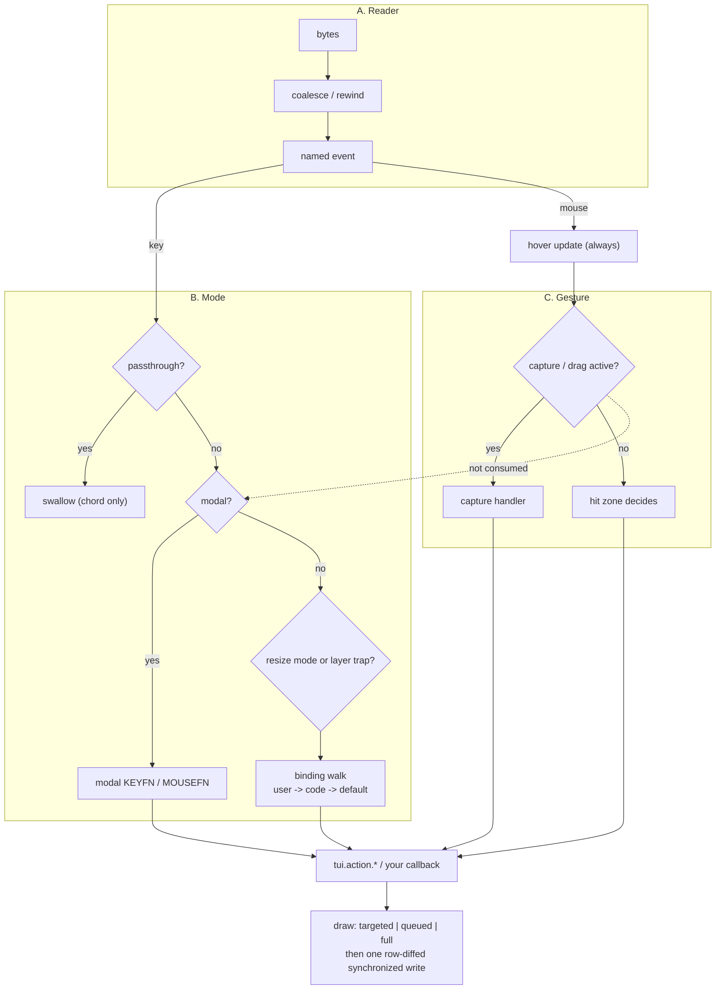

# Input state machine: events, modes and what the framework does with them

Companion to [lifecycle.md](lifecycle.md). That page follows a run in time; this one follows **one input event** from the terminal's bytes to the pixel, and shows every state that changes where the next event goes.

Source: `lib/core/tui_loop.sh` (reader), `lib/tui.sh` (`_tui._next_byte`, `_tui._read_escape_seq`), `lib/input/tui_input.sh` (naming, dispatch, coalescing, paste, actions), `lib/input/tui_mouse.sh` (hover, pointer shape, motion coalescing), `lib/input/tui_hit.sh` (hit index), `lib/chrome/tui_layer.sh`, `tui_modal.sh`, `lib/layout/tui_resize.sh`, `tui_collapse.sh`, `lib/widgets/tui_widgets.sh`.

Three machines run at once. They are drawn separately and tied together in [section 6](#6-how-the-machines-interact).

| Machine | Question it answers | State lives in |
|---|---|---|
| **A. Reader** | Which bytes make one event? | `_TUI_PENDING_INPUT`, `_TUI_SEQ_BUF`, `_TUI_REPEAT` |
| **B. Mode** | Who owns the keyboard and the pointer right now? | `_TUI_PASSTHROUGH`, `_TUI_MODAL`, `_TUI_L_TRAP`, `_TUI_RESIZE_PANE`, `_TUI_KEYS_SUSPENDED`, `_TUI_CAPTURE_FN` |
| **C. Gesture** | Is a mouse button down, and what is it doing? | `_TUI_CAPTURE_*`, `_TUI_RZ_ID`, `_TUI_L_DRAG`, `_TUI_SB_ORIENT`, text-selection state, `_TUI_HOVERED_*` |

## 1. Machine A: the reader (bytes to one event)

Every loop pass ([lifecycle §3](lifecycle.md#3-the-run-loop-libcoretui_loopsh)) calls `_tui._next_byte` once with a poll timeout and turns what it finds into at most one *logical* event.

### What the reader guarantees

| Input situation | What it does | Why |
|---|---|---|
| Mouse motion floods (a fast pointer) | Keeps only the newest motion report, so hover resolves once per settled position. A click, wheel notch or key peeked meanwhile is pushed back **byte for byte** and handled next, in order. | Motion is the only report safe to discard: presses, releases and wheel notches are state transitions. |
| `TUI_MOUSE_DRAIN_PEEK_TIMEOUT` | Must be `> 0`. | `read -t 0` consumes nothing, so the peek would never see anything. |
| Wheel spin | Identical wheel reports merge into one event with `TUI_EVENT_COUNT=n`; the scroll action multiplies its step by it. | One repaint for the burst, same distance. |
| Held key | Merged into one call with a count only when the receiver is **countable**: an open modal's `count_keys`, a focused list/table with up/down/page keys, a bound `tui.action.scroll`/`page`, resize mode arrows, or a bind made with `--count`. | Typing is never merged; a text input is never merged. |
| Split SGR mouse report on a slow link (SSH) | Once `ESC [ <` is seen the per-byte timeout rises (`TUI_ESCSEQ_MOUSE_TIMEOUT`). | A split report would leak `35;12;4M` into a focused input as typed text. |
| `ESC` followed by a printable byte | Complete immediately as `alt+byte`. | Waiting for a terminator that never comes cost a full timeout per key. |
| Lone ESC | Reads as `esc` after the per-byte timeout. | |
| Paste markers never closed | Gives up after about 2 s with what it has. | A broken terminal cannot hang the loop. |
| Raw feed to a focused input | The loop's direct "unbound key goes to the input" calls are disabled (`false && ...`); `_tui_input.feed_text` inside `key_event` does it. | One path for text. |

An event is then **named**: keys by `name_char` / `name_seq` (`a`, `ctrl+e`, `shift+up`, `f5`, `alt+x`, `space`, `enter`, `esc`), mouse by `name_mouse` from the SGR button byte: modifiers prefix (`ctrl+`, `alt+`, `shift+`), then `mouse:left|middle|right|sideN`, `drag:BUTTON`, `release`, `wheel:up|down|left|right`. An unnameable report (motion with no button, name empty) returns early and only drives hover.

## 2. Machine B: modes (who owns input)

Exactly one state is "in front". Higher ones hide the ones below them.

### Key routing: exact order (`_tui_input.key_event`)

First match wins. The numbers are the order in the code.

| # | Test | Outcome |
|---|---|---|
| 1 | name equals the passthrough chord | toggle passthrough, done |
| 2 | passthrough is on | swallow |
| 3 | `esc` and any layer exists, and a closable/autoclose layer is visible | `tui.layer.hide` topmost, done |
| 4 | (bookkeeping) set `TUI_EVENT_*`, notify `_TUI_ON_INPUT_EVENT` / `_TUI_ON_KEY_EVENT` | |
| 5 | name equals the keyboard kill-switch chord | toggle suspend, done |
| 6 | `_TUI_MODAL` open | `KEYFN name`, done (bindings, focus, scroll are all off) |
| 7 | `_TUI_RESIZE_PANE` set | `_tui_resize.key` (arrows, shift+arrows ±5, enter/esc leave); consumed unless not a resize key |
| 8 | a plugin registered a `key` hook | `tui.hook.fire key`; consumed if it returns 0 |
| 9 | keys suspended | only `enter` on a single-line text input and text-feed keys work |
| 10 | `_tui_input.dispatch` | binding table walk below |
| 11 | dispatch found nothing | `_tui_input.feed_text`: the focused text widget or list takes the key |

### Binding table walk (`_tui_input.dispatch`)

- **Typing wins.** While a text input has focus, printable keys, backspace, delete, space, left, right, home and end go to the input, even if a bind exists, unless the bind has `--always`.
- **Modal layer** (`_TUI_L_TRAP`, `_TUI_KEYS_OWNED=1`): user, pane and page binds are skipped; only the groups in `_TUI_L_KEY_GROUPS` (`focus click paste`) work. Tab and arrows therefore move within the layer, and the page behind never sees a key.
- Bind commands may be chained with `;`, run through `_tui.batch_call` so every draw they cause is flushed once.
- An unknown command sets `TUI_LAST_BIND_ERROR` ("no such command: X") instead of failing.

### Mouse routing: exact order

`_tui._handle_mouse` first, `_tui_input.mouse_event` second.

| # | Step | Detail |
|---|---|---|
| 0 | Passthrough on | stray in-flight reports are ignored |
| 1 | `_tui_hit.at X Y` | hit index lookup (per-row zone list, highest priority first): layer chrome, scrollbar, title, divider/handle/chevron, widget, hitbox, pane |
| 2 | Hover state | `_TUI_HOVERED_PANE`, `_TUI_HOVERED_WIDGET` (**draws now**, only on change), resize/collapse hover segment, pointer shape (OSC 22, only on change). This runs even while a modal is open. |
| 3 | `name_mouse` | |
| 4 | Capture | `_TUI_CAPTURE_FN` set → `drag` / `release` go to it, a new `mouse:*` press clears it and routes normally |
| 5 | Modal | `MOUSEFN name x y`, else ignored; **nothing else sees it** |
| 6 | Left press outside a modal/popup layer | `_tui_layer.outside`: modal swallows it, popup closes. A press inside a layer raises it. |
| 7 | Layer chrome | header drag (move), corner (size), `btn:close/min/full/reset/dock`, detach |
| 8 | Collapse chevron (`cv-*`) | `tui.collapse ID toggle` |
| 9 | Resize handle (`rz-*`) or an active resize drag | `_tui_resize.mouse` |
| 10 | `_tui_input.dispatch` | bindings for `mouse:left`, `drag:left`, `wheel:*`, `release`, `mouse:right`, `mouse:sideN` ... same table walk as keys |

## 3. Machine C: the pointer gesture

A button is **up** or **down**; what "down" means depends on what the press landed on.

```mermaid
stateDiagram-v2
  [*] --> Hover
  Hover --> Hover: motion<br/>(change-gated hover draw,<br/>pointer shape)
  Hover --> Wheel: wheel event
  Wheel --> Hover: scroll action done

  Hover --> PressButton: mouse:left on button
  Hover --> PressCheckbox: mouse:left on checkbox
  Hover --> PressText: mouse:left on input / textarea
  Hover --> PressList: mouse:left on list / table
  Hover --> PressSelect: mouse:left on select
  Hover --> PressScrollbar: mouse:left on scrollbar zone
  Hover --> PressHandle: mouse:left on rz-* zone
  Hover --> PressChevron: mouse:left on cv-* zone
  Hover --> PressLayerChrome: mouse:left on layer header, corner, button
  Hover --> PressPane: mouse:left on pane / label / empty space
  Hover --> PressOther: mouse:right, middle, sideN

  PressButton --> PressButton: capture: held, no action yet<br/>(focus + pressed look)
  PressButton --> Hover: release over the button:<br/>action runs, then one batched draw
  PressButton --> Hover: release elsewhere:<br/>no action, un-press draw

  PressCheckbox --> Hover: toggles immediately on press
  PressText --> TextSelecting: drag:left
  PressText --> Hover: release
  TextSelecting --> TextSelecting: drag extends selection
  TextSelecting --> Hover: release

  PressList --> Hover: press selects row;<br/>second press on same row within 450 ms = action
  PressSelect --> SelectModal: tui.choose opens a modal
  SelectModal --> Hover: choose / esc (machine B: Modal)

  PressScrollbar --> ScrollbarDrag: tui.mouse.capture<br/>+ jump to pointer
  ScrollbarDrag --> ScrollbarDrag: drag follows pointer<br/>even off the bar
  ScrollbarDrag --> Hover: release

  PressHandle --> HandleDrag: _TUI_RZ_ID set<br/>(second press within 400 ms = reset)
  HandleDrag --> HandleDrag: drag: weight moves between siblings,<br/>clamped to min/max
  HandleDrag --> Hover: release (re-hover check)

  PressChevron --> Hover: collapse toggles

  PressLayerChrome --> LayerDrag: header = move, corner = size
  LayerDrag --> LayerDrag: drag
  LayerDrag --> Hover: release
  PressLayerChrome --> Hover: close / min / full / reset / dock / detach

  PressPane --> Hover: markdown link follows, else<br/>scrollable pane takes keyboard focus,<br/>else focus cleared (sticky input keeps it)
  PressOther --> Hover: only if a bind exists
```

### Details that matter

- **A button fires on release, and only if the pointer is still over it** (`_tui_input.button_held`). Press only focuses it and gives it the pressed look. So dragging off a button cancels the click.
- **Order inside the release handler**: focus and hover are cleared **first**, the action runs **before** any paint, then one batched draw. A spammed button therefore never queues clicks behind un-press redraws. If the action repainted the whole screen (`tui.goto`) or removed the widget, the extra draws are skipped (`_TUI_RENDER_SEQ` check).
- **A lost release** cannot wedge the pointer: any new `mouse:*` press clears a stale capture, and a new press also clears a stale resize or layer drag state.
- **Scrollbar zones are 3 cells wide** (bar ±1, clamped), and the vertical zone wins the shared corner.
- **List/table double click** is detected by time (450 ms) and row, kept in `_WX_CLICK_*`. The first press selects (and fires `on_change`), the second runs the action.
- **Text selection** drags only while a text widget is focused; otherwise a `drag:left` only moves scrollbars (`tui.action.click` handles both).
- **Hover is feedback, not work**: it paints immediately (one cheap single-widget write), never debounced.

## 4. Event catalogue: what the framework does with each

| Event | Name(s) | Default handler (group) | What changes on screen | Draw path |
|---|---|---|---|---|
| Tab / Shift+Tab | `tab`, `shift+tab` | `tui.action.focus_next/prev` (focus) | focus ring, pane border | targeted widgets + pane border, row-diffed |
| Arrows (no text focus) | `up down left right` | `tui.action.focus_dir` (focus) | focus moves to the nearest widget in that direction | targeted |
| Arrows (list/table focused) | | consumed by the widget while it can move | selection | `_tui_wx.redraw` |
| Enter | `enter` | `tui.action.activate` (focus) | button action, checkbox toggle, input submit, list/table action, select opens a `tui.choose` modal | per widget; a page switch renders once |
| Esc | `esc` | layer dismiss, else `tui.action.unfocus` | closes topmost closable layer, else drops focus | targeted |
| Printable, edit keys | | consumed by focused input/textarea (`_tui_text`) | text, cursor, selection | the widget only; `on_change` can be debounced |
| Scroll keys | `shift+arrows`, `j k h l`, `pgup pgdn home end` (scroll) | `tui.action.scroll/page/scroll_top/bottom` | target pane offset | `_tui_scroll.apply`, queued then flushed when input settles |
| Pane focus | `f6`, `shift+f6`, `alt+arrows` (pane) | `pane_next/prev`, `scroll_or_pane` | keyboard pane, its border | border redraw |
| Resize mode | `alt+r`, `alt+shift+r`, `alt+c` (resize) | `resize_mode`, `page_reset`, `collapse_toggle` | pane sizes, collapsed state | frame request, one relayout |
| Command bar | `ctrl+p` (always), `:` (palette) | `tui.palette.open`: opens a modal | overlay on top of the page | layer cover, appended to the same write |
| Wheel | `wheel:up/down/left/right`, with `shift`/`ctrl` | `tui.action.scroll` (wheel) | widget wheel first (`_tui_wx.wheel`), else pane under the pointer | bursts merged, one repaint |
| Click | `mouse:left` (click) | `tui.action.click` | see machine C | per widget kind |
| Right / middle / side buttons | `mouse:right`... | no default; user binds, `contextmenu` layers | whatever the bind does | |
| Markdown keys | `alt+j/k/l`, `alt+left/right` (markdown) | link nav, history | link focus, document | markdown caches |
| Paste | bracketed paste | `tui.action.paste` | inserts into the focused text widget (single-line: newlines become spaces, controls dropped) | the widget |
| Terminal resize | `SIGWINCH` | `tui.on_resize` sets a flag | whole screen | [lifecycle §5.1](lifecycle.md#51-resize) |
| Tick | none (time) | listeners | clocks, jobs, painters | targeted |
| Quit | `q`, `ctrl+q` (always) (quit) | `tui.action.quit` | asks first if `confirm.quit` is on, else `tui.stop` | |

Defaults are **data** (`share/defaults/keybinds.xml`, groups: `focus pane scroll resize help markdown markdown_reader click wheel paste palette pages quit`), so anything above can be turned off per app or page (`tui.defaults.off GROUP`, `<tui defaults="-GROUP">`) or overridden by a bind.

## 5. Edge cases and how each is handled

| Situation | Handling |
|---|---|
| Callback calls `tui.goto` | The goto renders once; draws made during the build return early (`_TUI_DEFER_RENDER`). A button release sees the render counter changed and skips its own repaint. |
| Callback removes or replaces the widget it was called for | After the action, `button_held` and `activate` re-check that the widget id still exists before drawing or restoring focus. |
| Callback is slow | Nothing preempts it: the loop is single-threaded. Hover and clicks that arrive meanwhile wait in the tty buffer and are then **coalesced** (motion keeps the newest, wheel/keys merge). Use `tui.job.run` for slow work. |
| Click while a job spinner is up | Normal input; the spinner is just an overlay redrawn after frames. |
| Modal open, pointer moves | Hover bookkeeping still runs (pointer shape asks the modal's `POINTERFN`); clicks go only to the modal's `MOUSEFN`. |
| Press on the page under a modal layer | Swallowed (`_tui_layer.outside`); under a popup it closes the popup. |
| Release lost (terminal lost focus mid-drag) | Next press clears capture / resize drag / layer drag. |
| Terminal resized during a drag or modal | Applied at the top of the next pass; `_tui_async.hold` pauses painters until the page has answered. While passthrough is on, resize waits and is applied on exit. |
| Keys suspended (`ctrl+alt+k`) | Bindings off, mouse unaffected; a focused text input still types and `enter` submits a single-line input. A small overlay is drawn each pass while suspended. |
| Passthrough | Mouse reporting switched **off** (the terminal does selection, right-click, URL clicks, wheel), pending input dropped, screen frozen, background output queued and applied on exit by one `tui.relayout`. Only the chord works. |
| Bound command does not exist | `TUI_LAST_BIND_ERROR`, no crash. |
| Unknown or unnameable key | `_KEY` empty → `key_event` returns 1 → nothing bound, nothing fed. |
| Held arrow in resize mode | Merged into one batch of single steps (weights round per step), one commit, one repaint. |
| Same key bound in pane scope and globally | Pane scope first; both can run if the first has `--pass`. |

## 6. How the machines interact

Rules of thumb that fall out of the diagram:

1. **Hover always happens first** and is never blocked by a mode (except passthrough). That is why the pointer shape and hover highlight keep working under a modal.
2. **Capture beats modal beats layer beats zone.** A drag started on the page is finished by its capture even if a layer appears.
3. **Keys and mouse share one binding table** and one dispatcher; only the *pre-routing* differs.
4. **Modes never queue input.** A key pressed in a mode is handled by that mode now, or dropped; it is not replayed when the mode ends (the only queue is the reader's rewind buffer, which preserves order within one burst).
5. **Every path ends in the same renderer**: a targeted draw, a queued pane render, or a full `tui.render`; all end in `_tui._flush`, which adds the overlay stack and diffs rows. See [lifecycle §3.2](lifecycle.md#32-draw-path-what-a-change-costs).

## 7. Debugging an input problem

| Symptom | Look at |
|---|---|
| A key does nothing | `tui.defaults.list` (group off?), a modal or layer trap owning keys, typing mode (`_tui_wx.consumes`), `TUI_LAST_BIND_ERROR` |
| Click does nothing | `_tui_hit.at` result (`TUI_EVENT_ZONE`, `ZONE_ID`), a modal swallowing it, an autoclose popup eating the press, a stale capture |
| Hover stuck | hit index dirty (missing `epoch_bump hit` / `widgets`), see [caches.md](caches.md) |
| Stray characters typed into an input | split mouse report (raise `TUI_ESCSEQ_MOUSE_TIMEOUT`) |
| Scroll feels laggy or jumps | coalescing disabled (`TUI_INPUT_COALESCE=0`), or the callback is slow |
| Everything frozen | passthrough on (box on screen), or keys suspended |
| `dabt --debug` | status strip shows last input name and ms; the `_TUI_ON_INPUT_EVENT` and `_TUI_ON_KEY_EVENT` callbacks see every event, mouse motion included (name `move`) |
