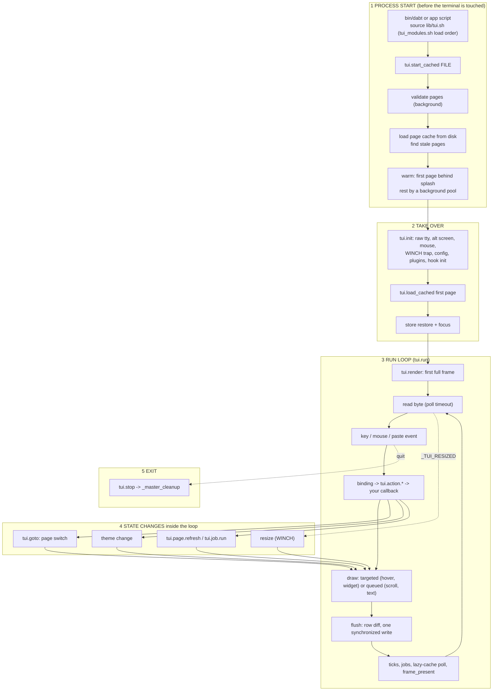
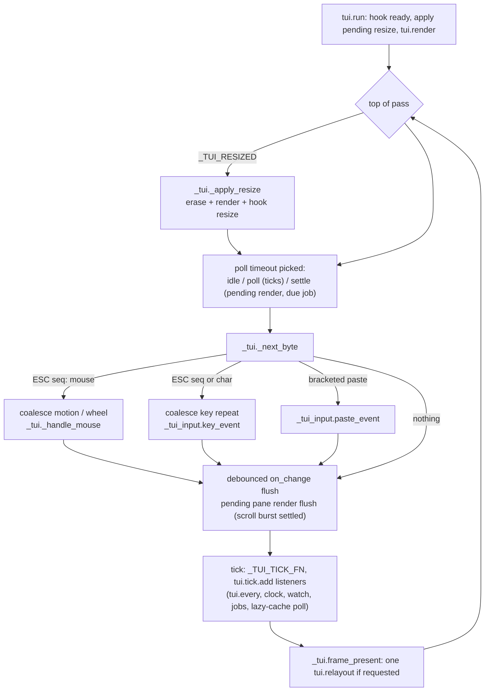
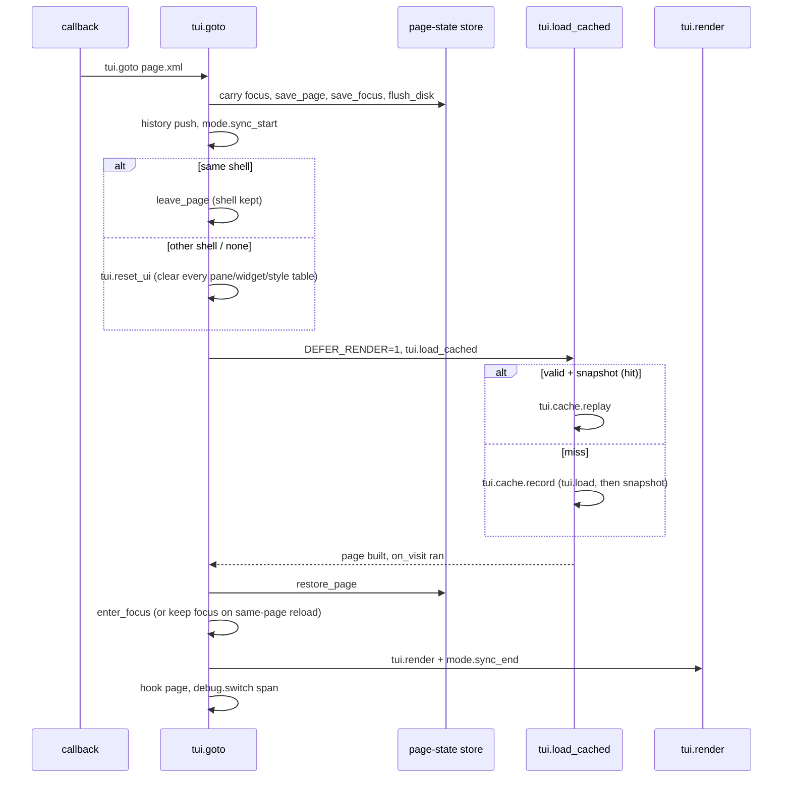

# The life cycle of a DABT app

One page that follows a run from `dabt` to the terminal being handed back, and says at every step **what runs, which cache is read or written, and what makes that cache stale**. Read it top to bottom once; later use the [trigger table](#7-trigger-table-i-did-x-what-happens) and the [cache atlas](#8-cache-atlas) as a lookup.

Related, deeper pages: [caches.md](caches.md) (every cache's key and owner), [layers.md](layers.md), [../guide/performance.md](../guide/performance.md) (how to write fast apps), [pages-templates-addons-refresh](../concepts/pages-templates-addons-refresh.md).

## 0. The whole thing on one screen



Three clocks run through all of this:

| Clock | Where | What it means |
|---|---|---|
| **Build time** | start-up, or the first visit of a page, or a background worker | Parse XML, run tag handlers, lay out. Expensive (400-650 ms for a page). The result is cached. |
| **Replay time** | every `tui.goto` after the first | One `eval` of a saved `declare -p` snapshot, then the *dynamic* parts re-run live. 50-65 ms. |
| **Frame time** | every loop pass | Compose changed fragments, diff rows, one write. Budget: feedback inside a blink, no forks. |

## 1. Process start (before the terminal is touched)

| Step | Code | What happens | Caches / state |
|---|---|---|---|
| 1.1 Home | `lib/tui_home.sh` `_tui_home.locate` | Finds `TUI_HOME` (`~/.config/DABT`) in order: `TUI_HOME`, default dir, `DABT_HOME`, config line; else flags it missing. | sets `TUI_HOME_SOURCE`; everything on disk below hangs off `$TUI_HOME` |
| 1.2 Source the library | `lib/tui.sh` → generated `lib/tui_modules.sh` | Modules are sourced in dependency order (`# requires:` headers, `tools/gen_load_order.sh`). All global tables are declared here, empty. | default keybinds and commands are **replayed from a snapshot**, not re-parsed (see 1.3). Source time about 71 ms |
| 1.3 Default binds and commands | `tui.bind.defaults` (`input/tui_input.sh`), `tui.cmd.load` (`chrome/tui_cmd.sh`) | A script of `bind`/`cmd.add` calls is kept on disk and `source`d. | `$TUI_HOME/cache/keybinds/<path>.v1.snap`, `.../commands/<path>.v1.snap`. Stale when the XML is newer (`-nt`) or the `v1` in the name changes with the parser |
| 1.4 Choose the pages | `tui.start_cached` (`markup/tui_cache.sh`) | Page set = every `*.xml` in the app dir and in `$TUI_DEFAULTS_DIR/pages`, except names starting with `_` (shells and includes). | none |
| 1.5 Validate | `_tui_validate.begin/finish` (`markup/tui_validate.sh`) | Walks every page and include with the registered rules (file/line/col errors). Runs **in the background** (`TUI_VALIDATE_ASYNC=1`) while 1.6-1.8 proceed, and is joined before anything is persisted. Errors abort the start unless `--ignore-invalid-xml`. | `$TUI_HOME/cache/validated`: page list plus `mtime path` of every file read. A differing mtime re-runs the walk |
| 1.6 Load the disk page cache | `tui.cache.load_dir` | Reads `$TUI_HOME/cache/pages/<path>.page` (one file per page; the entry sits between a version tag and an end marker, a file without the marker is ignored). | fills `_TUI_CACHE_PAGE/SIG/SCRIPTS/ON_VISIT/GOTOS/THEME/CLASSES/SHELL/SIZE` |
| 1.7 Which pages are stale? | `tui.cache.valid` | A page is valid when it has an entry **and** the mtimes in its signature match (page file, includes, `<theme>` files and their `@import`s, addon files, plugin deps, its shell). | signature = `path=mtime;...` in `_TUI_CACHE_SIG` |
| 1.8 Size check | `_tui_cache_resized` | A cached page laid out for another terminal size is marked for a *re-fit* (cheap re-layout, 40-170 ms) instead of a rebuild. | `_TUI_CACHE_SIZE[page]` = `"rows cols"` the geometry was laid out for |
| 1.9 Warm | `tui.cache.warm_with_spinner`, `_tui_cache_lazy.*` | **Lazy mode** (`TUI_CACHE_LAZY=1`, default): only the *first* page is built behind the splash, by a forked headless worker. The remaining stale pages go to a **pool driver** forked now, before the terminal is taken over, which builds them while the app runs. With one or no stale page, or lazy off, all stale pages are built behind the splash. | worker writes a `.snap` atomically (tmp + `mv`); parent installs it with `tui.cache.decode`; `tui.cache.dump_dir` persists to `cache/pages` straight away so a quit mid-pool still leaves page 1 warm |
| 1.10 Trust | `_TUI_CACHE_TRUSTED=1` | From here on, source files are **assumed unchanged**: `tui.cache.valid` returns true without a `stat`. | `TUI_CACHE_TRUST=0` re-enables the per-switch check (for developing a page) |

Why workers are safe: they run `tui.init` + `tui.cache.record` with stdin and stdout on `/dev/null` and `_TUI_WARM_WORKER=1`, so they cannot grab the tty or paint.

## 2. Taking over the terminal

`tui.init` (`lib/tui.sh`), then the first page, then focus:

| Step | What happens |
|---|---|
| `tui.errors.capture on` | stderr goes to the app log from now on, so a complaint cannot paint over the screen. |
| `trap tui.on_resize WINCH` | Installed *here*, not in `tui.run`, so a resize during a slow warm-up is not lost. |
| `tui.config.apply` | Saved framework settings (`dabt.conf`): theme overlay, default-key groups, input behaviour. Sets `_TUI_THEME_OVERLAY`. |
| `stty -echo -icanon -isig -ixon -iexten`, alt screen, mouse, bracketed paste | Every key belongs to the app. An `EXIT` trap (`_master_cleanup`) guarantees the terminal is given back. |
| root pane | `root` gets row 1, col 1, the terminal's size, a border. |
| `_tui_home.touch`, `tui.plugin.startup`, hook `init` | `app.meta` (last run, run count); plugins discovered and enabled; plugins run their `init`. |
| `tui.load_cached FILE` | See [section 4](#4-a-page-switch-tuigoto). Normally a **replay**. |
| `_tui_store.restore_page`, `enter_focus` | Kept widget values/scroll/collapse come back; focus lands on the first focusable (or `focus_on_enter`). |
| `_tui_validate.notify`, `_tui_cache_lazy.announce` | Shows "N configuration errors ignored" and the "Building the page cache in the background" toast when the pool still has pages to build. |
| `tui.run` | Next section. |

## 3. The run loop (`lib/core/tui_loop.sh`)



Rules the loop enforces:

- **Ticks are time-based**, not per-iteration: pointer motion cannot speed a clock up. `tui.every`, `tui.clock`, `tui.watch`, `tui.monitor`, `tui.exec` and `tui.job.run` all ride the same listener list.
- **Pending content renders are debounced** (`_TUI_RENDER_TIMEOUT`, wheel/scroll bursts) but **hover, focus and key feedback draw immediately**. The poll timeout drops to the "settle" value while anything is queued so a burst does not wait the full idle poll.
- **Frame requests collapse**: any number of `tui.frame.request` in one pass cause one `tui.relayout` at the end.
- **Overlays redraw only after a real flushed frame.**
- Terminal-control mode (`_TUI_PASSTHROUGH`) drains input but draws and ticks nothing.

### 3.1 Input path

```
bytes -> _tui._next_byte
  mouse:  _tui._handle_mouse
            _tui_hit.at COL ROW        hit index: per-row list of zones, highest priority first
            hovered pane/widget set     (draws hover feedback right away)
            _tui_input.mouse_event      -> binding table
  key:    _tui_input.key_event
            passthrough chord, esc closes top layer, modal owns keyboard,
            resize mode, plugin key hook, keybind kill-switch
            _tui_input.dispatch NAME    user binds -> code binds (tui.bind, <bind>) -> defaults, first match wins
            unbound -> _tui_input.feed_text (a focused text widget gets the key)
  binding -> tui.action.* (activate, focus, scroll, goto, back ...) -> your callback
```

### 3.2 Draw path (what a change costs)

| Change | Entry | Path | Written |
|---|---|---|---|
| Hover, focus, press | `_tui._draw_ids_now DRAWFN IDS` | compose the affected ids into one buffer → `_tui_paint.flush` | only rows whose bytes differ from the last flush |
| `tui.update ID TEXT` | `_tui._draw_or_queue` → `_tui._draw_widget` | one widget; `tui.update_changed` skips when the value is equal | row-diffed |
| `tui.set_text PANE TEXT` | skipped if equal to the last text; else `_tui._queue_render` | flushed once input goes quiet | one synchronized write |
| `tui.set_canvas` | immediate, row-diffed against its own last frame | for animation | changed rows only |
| Layout change, page switch, resize, theme | `tui.render` (or `tui.relayout`) | all panes, junctions, hit overlay, all widgets, scrollbars, pane content, layer stack → **not diffed** (almost every row differs; the split costs more than it saves) | one synchronized write; becomes the saved base frame |

`_tui._flush` is the only writer. During a `tui.goto` (`_TUI_DEFER_RENDER`) draws are swallowed because the goto paints the whole screen once afterwards. Layers, the palette and dialogs are appended to the same write so the page is never visible without them.

## 4. A page switch (`tui.goto`)



### 4.1 Replay (cache hit), in order

1. `tui.cache.valid` (free when trusted).
2. Shell page: ensure the shell is live, `leave_page`; else `_tui_cache_restore`: one `eval` of the `declare -p` snapshot of every `_TUI_P_*`, `_TUI_W_*`, `_TUI_TABS_*`, focus and factory table. Focus, hover and cursor are then cleared so `on_visit` sees what a fresh build sees.
3. `epoch_bump style` and `layout`: the restore replaced the style tables, and the layout memo belongs to the previous page.
4. Re-apply the page's `<theme>` (`tui.load_theme`, itself memoized).
5. Re-bake per-widget styles from the class table **only if** the overlay now differs from `_TUI_STYLE_SIG` (the overlay the snapshot was baked under).
6. Re-add the footer layer; clear exec controls whose process died.
7. **Always live, never cached:** `<script src>` is re-sourced (pages run top-level setup code), nav-button handlers are re-defined (`_tui_cache_define_goto`), `on_visit` runs.
8. Relayout is **skipped** when the terminal size, footer state and debug-bar rows match the snapshot and nothing the scripts did bumped the layout generation (`relayout_skipped` counter). Otherwise `_tui_cache_relayout`.

### 4.2 Record (cache miss)

`tui.cache.record` = `tui.load` (shell, default theme, `tui_build.load`: tokenize → addons → templates/loops/conditions → one handler per tag creates panes and widgets → layout → `on_visit`) + capture: snapshot via `declare -p` filtered by `_TUI_CACHE_STATE_REGEX`, the lists of scripts, gotos, classes, theme, on_visit, size, shell delta and the dependency **signature**. The raw parsed tree and a signature per pane are part of the snapshot, so `tui.page.refresh` works after a replay.

### 4.3 What a goto does *not* repeat

- one paint (a draw during load returns early; the switch renders once),
- the `stat` of the sources (trusted cache),
- re-layout (size match),
- style re-bake (overlay match),
- the shell (same-shell pages keep its panes, focus, timers, binds).

## 5. Things that happen in the middle of a run

### 5.1 Resize
`SIGWINCH` → `tui.on_resize` sets `_TUI_RESIZED`. At the top of the next pass `_tui._apply_resize` waits until the size stops changing (up to 25 × 40 ms), reads the size, re-derives root w/h and lays out the whole tree; then `erase.all`, a full `tui.render`, hook `resize`, `_tui_api.on_resize`, `_TUI_ON_RESIZE_FN`. Painters are held while this runs.
In the background: after `TUI_CACHE_RESIZE_DEBOUNCE_MS` (300) at one size, `_tui_cache_lazy.on_resize` asks the pool to **re-fit** every cached page to the new size; results arrive through the tick listener (`_tui_cache_lazy.poll_one`) and replace only the geometry (`.rsnap`). So the first visit after a resize usually replays without a relayout.

### 5.2 Theme change
`tui.theme.set/clear` → `_TUI_THEME_OVERLAY` changes → `tui.theme.reload` → `_tui.theme_reset` (drop old classes) → `tui.goto` of the *same* page (focus and cursor kept). That is a replay with step 5 (re-bake) active. Other cached pages notice the changed overlay on their next visit through `_TUI_STYLE_SIG`.

### 5.3 Incremental page change (`tui.page.refresh`)
Reloads the remembered raw tree (no parse), applies the addons now on disk, expands templates, signs the result and compares with the per-pane signatures. Only changed panes are torn down and rebuilt; state of untouched panes survives. If the change is outside the panes, in a pane without an `id`, in `<tabs>`, or the root: it falls back to `tui.page.rebuild` (background, spinner). About 45 ms for an addon switch.

### 5.4 Slow work (`tui.job.run ID WORKFN DONEFN`)
`WORKFN` runs in a background subshell (cannot change your variables); its stdout is `OUTFILE`. A spinner appears after 100 ms (`--silent`: never). Each loop pass the job tick checks it; on completion `DONEFN ID RC OUTFILE` runs **in the main shell**, the only place the result touches the screen. Same ID starts cancel the earlier job.

### 5.5 Overlays
Layers (`chrome/tui_layer.sh`), the footer, toasts, palette and dialogs are drawn *after* every page flush in the same write. `tui.modal.open` makes a layer own the input; `tui.modal.dismiss` replays the **saved base frame** instead of re-rendering the page (palette close 38 → 14 ms), valid only if nothing restyled, resized or repainted meanwhile.

### 5.6 Page state across switches
`_TUI_STORE["PAGE|ID|FIELD"]`: widget value, cursor, scroll, selection, collapsed, pane size, for items with `keep_*` or `persist="disk"` (written to `$TUI_HOME/state/store`, loaded once on first use, never `source`d).

## 6. Exit
`q`/`tui.stop` → hook `quit`, loop ends → `_master_cleanup`: `_tui_store.exit` (state to disk), hook `exit` (plugins undo changes), `tui.cache.cleanup` (stop the pool, remove the theme stamp dir), `_tui_api.shutdown`, `_exec_cleanup_all` (process trees: TERM, one 50 ms wait, HUP, KILL), stop async painters, `tui.cleanup` (mouse/paste off, main screen, drain unread input, restore `stty`), final hard reset sequence. Also runs from the `EXIT` trap and `INT/TERM/HUP`.

## 7. Trigger table: "I did X, what happens?"

| I do... | Immediate effect | Caches touched | Becomes stale / must be redone |
|---|---|---|---|
| Edit a page, include, theme, addon or shell file **while the app runs** | Nothing (cache trusted) | none | Next **start**: signature mtime differs → rebuild. With `TUI_CACHE_TRUST=0`: next switch. Call `tui.cache.forget FILE` for a live change |
| Edit a page then start the app | Validate + rebuild that page (first page behind splash, rest by the pool) | page cache entry replaced, disk file rewritten | validated record |
| Edit a `<script src>` callback file | Takes effect on the **next visit** | none: scripts are never cached | nothing |
| Change `on_visit` code | Next visit | none | nothing |
| Change the XML schema/validator or the snapshot format | `v1` snapshot tag / `DABT-PAGE-1` tag must be bumped | keybind/command snapshots, page files | everything keyed on the tag |
| Move the mouse | hit lookup, hover draw, one row-diffed write | hit index (rebuilt only when dirty), row cache, SGR/width memos | none |
| Press a key / click a button | binding → action → callback | none directly | whatever the callback changes |
| `tui.update` / `tui.set_text` | widget or pane redraw (debounced for text) | row cache (content-addressed), `_TA_LAST` | nothing |
| Change a split, gap, pad, size, collapse | `_tui.epoch_bump layout` (+ `hit`) | layout memo (`_TUI_LY_GEN`), widget position cache, hit index, junctions | next layout recomputes |
| Write a style table / class | `_tui.epoch_bump style` | saved base frame (modal dismiss) | dismiss falls back to a full repaint |
| Add/remove widgets or change a type | `_tui.epoch_bump widgets` | focus order, hit index | rebuilt by next lookup |
| `tui.goto` another page | [section 4](#4-a-page-switch-tuigoto) | page cache, theme memo, layout memo reset | on_visit/scripts re-run |
| Resize the terminal | [section 5.1](#51-resize) | paint diff reset, layout, background re-fit of cached pages | `_TUI_CACHE_SIZE` per page |
| `tui.theme.set` | [section 5.2](#52-theme-change) | theme memo, style bake, row cache by key | other pages' re-bake on visit |
| `tui.page.refresh` | [section 5.3](#53-incremental-page-change-tuipagerefresh) | pane signatures, raw tree | falls back to rebuild when it cannot |
| Open a Markdown file | render once per (file, width, flags) | Markdown caches ([caches.md](caches.md#markdown-caches)) | style change, new width, flags |
| `dabt update` / `dabt clear-cache` | defaults or caches replaced | `$TUI_HOME/cache/*` | everything rebuilt on next start |

## 8. Cache atlas

Grouped by **lifetime**. Key, owner and `TUI_CACHES=off` behaviour per cache: [caches.md](caches.md).

### 8.1 On disk (survives restarts)
| Where | What | Valid while |
|---|---|---|
| `$TUI_HOME/cache/pages/<path>.page` | built page snapshot + scripts, gotos, classes, theme, size, shell delta | signature mtimes match (checked at start), format tag matches |
| `$TUI_HOME/cache/keybinds/…v1.snap`, `cache/commands/…v1.snap` | default binds and commands as replayable scripts | XML not newer; parser version in the name |
| `$TUI_HOME/cache/validated` | "this page set passed validation" | every listed file mtime unchanged |
| `$TUI_HOME/cache/markdown/…memo`, `…@WIDTH.rows` | inline memo; rendered rows for a width | stored signature/key equals today's; file not newer; written whole |
| `~/.cache/DABT/md-images` | converted or fetched pictures | source unchanged |
| `$TUI_HOME/state/store` | `persist="disk"` page state | data file, never sourced |

### 8.2 In process, whole session
| State | Role | Stale when |
|---|---|---|
| `_TUI_CACHE_PAGE/SIG/SCRIPTS/ON_VISIT/GOTOS/THEME/CLASSES/SHELL/SIZE/PAGEUNDO/PAGEGEO` | page cache | start-up signature check (then trusted); `tui.cache.forget`; size changed → re-fit |
| `_TUI_THEME_MEMO/STAMP/DEPS` | parsed stylesheets | file or an `@import` mtime changes (unless trusted) |
| `_TUI_LAZY_*` | pool driver, fifo, per-generation snapshot dirs | a newer generation cancels the older |
| `_TUI_STORE*` | page state | explicit reset |
| `_TUI_P_RAW`, `_TUI_P_SIG_*` | tree and signatures for refresh | rewritten by every build/refresh |

### 8.3 In process, content-addressed (never stale, bounded)
`_TUI_RC` row-fragment cache (4096), `_TUI_SGR_MEMO`, `_TUI_VW_MEMO`, `_TUI_VS_MEMO` (4096 each), widget position cache `_TUI_WPC`, Markdown line/inline memos. A changed input is a different key, so there is nothing to invalidate; anything with a `${expr}` text is simply not stored.

### 8.4 In process, generation / dirty-flag caches (**must** be bumped)
| Cache | Bumped by (`_tui.epoch_bump KIND`) |
|---|---|
| Layout memo | `layout` |
| Saved base frame | `style` (also resize, any unfolded flush) |
| Hit index | `widgets`, `hit` |
| Focus order | `widgets`, `focus` |
| Paint diff (`_TUI_PAINT_PREV`) | `tui.paint.reset` (erase, resize, takeover) |
| Junction cache | recompared every pass |

Never write another module's counter. Call `_tui.epoch_bump`.

## 9. Switches and instruments

| Variable | Effect |
|---|---|
| `TUI_CACHES=off` | Bypasses every dirty-flag cache, the page cache and theme memo. Behaviour must be identical; a difference is a missing bump. `tools/decoupling/cache_ab.sh` compares both modes frame by frame. |
| `TUI_CACHE_TRUST=0` | Per-switch source check (develop pages). |
| `TUI_CACHE_LAZY`, `_WORKERS`, `_PREP`, `_NICE` | Background build pool. |
| `TUI_CACHE_RESIZE_DEBOUNCE_MS` | Delay before re-fitting after a resize; `0` off. |
| `TUI_ROWCACHE=0`, `TUI_DISMISS_REPLAY=0` | Individual caches off. |
| `TUI_VALIDATE`, `TUI_VALIDATE_ASYNC`, `TUI_VALIDATE_JOBS` | Validation. |
| `TUI_DEBUG` / `dabt --debug` | Status strip: last visit `hit|miss N ms`, last switch, last input; `cache.page.miss` events. |
| perf counters | `cache_hit`, `cache_miss`, `relayout_skipped`, `rowcache_hit/miss`, `full_renders`, `bytes_flushed`, `bytes_suppressed`, `cache_refit` |
| `$TUI_HOME` log (`tui.log.file`) | `TUI_LOG_LEVEL=debug` logs every record/replay decision (about 12 ms per build). |
| `dabt clear-cache` | Wipes the on-disk caches. |

## 10. Debugging by symptom

| Symptom | Likely boundary | Check |
|---|---|---|
| Edited page does not change | trusted cache | restart, or `TUI_CACHE_TRUST=0` |
| Old colours after a theme switch | style bake / `_TUI_STYLE_SIG` | `TUI_CACHES=off` reproduces? |
| Layout wrong after programmatic size change | missing `epoch_bump layout` | call the setter that bumps, not the array |
| Stale hover/click target | hit index dirty | missing `epoch_bump widgets` or `hit` |
| Modal close shows old page | saved base frame stale | missing `epoch_bump style`, or repainted under it |
| First visit of a page slow after update | pool still building | the "Building the page cache" toast |
| First visit after a resize slow | re-fit not finished | debounce (300 ms) plus pool time |
| Callback work runs once, not per visit | it is in the page snapshot | put it in `on_visit` or a re-sourced `<script>` |
| Page looks right with caches off, wrong with them on | a cache boundary bug | `tools/decoupling/cache_ab.sh PAGE` |

## Adding a new cache

1. Prefer a **content-addressed** key holding every input (no invalidation needed); skip it for non-plain values.
2. Otherwise add an `_tui.epoch_bump` kind and call it from whoever changes the inputs.
3. Guard the lookup with `((_TUI_CACHES))`.
4. Add a row to [caches.md](caches.md) *and* to the atlas above, and a perf counter for hit and miss.
