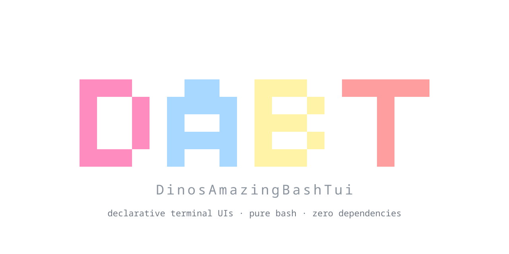

<div align="center">


<h1></h1>
</div>
<h3 align="center"><em>Web development like page building?<br>Web development like debugging!</em></h3>

Pages are data, and building one already feels like writing a web page. This release brings the other half of that workflow: `dabt --debug` opens a status strip and a dev-tools dock inside the running app, the way a browser's developer tools sit beside a page. Watch events as they happen, see which pages are cached and how long each load, switch and keypress took, and read perf spans and counters, all without leaving the terminal and without costing a normal run anything.

The same release makes the everyday paths quicker: markdown search, templates with `<if>` alternatives, the Scrolling demo page, and demo pages that now redraw only what changed (and hopefully this is the last time I have to write that sentence).

<h2></h2>

- **`dabt --debug` shows what the app is doing: a live status strip and a dev-tools dock inside the terminal.**
- **F12 toggles the status strip, F11 the dock with its Events, Pages, Perf and Counters tabs.**
- **Debug mode costs a normal run nothing: hot paths pay one arithmetic test.**
- **The Scrolling page opens in about half the time.**
- **Templates with `<if>` alternatives only build the branch they use.**
- **The Scrolling page fills the terminal on first launch.**
- Cold first visit of the Scrolling page at 60 rows: 2.5 s to 1.1 s.
- Expanding a template use with ten `<if>` branches clones 1 branch instead of 10.
- A first launch builds the Scrolling page once instead of twice.
- **Redraw only what changed: `tui.update_changed` skips the draw when a widget already holds the value.**
- **Demo pages refresh on timers, not tick counters.**
- **The Widgets status line repaints 0 times a second while idle, down from about 3.**
- **The Monitor page no longer runs a callback on every main-loop iteration (about 20 a second).**
- **Plugins page clicks fork up to 8 times less; the Settings and Keybinds handlers fork none.**
- **The Monitor's interval input runs no `awk`.**
- **Searching a markdown document is up to 3x faster.**
- **Marking a search match in 2000 rows drops from 800 ms to 237 ms.**
- **Stepping through search matches skips rows without a match: 170 ms down to 47 ms for 2000 rows.**

<h2></h2>

- `dabt --debug[=CATEGORIES]`: status strip (F12) and dev-tools dock (F11).
- Dev-tools dock tabs: Events, Pages, Perf, Counters; keys for scroll, pause, filter, clear and maximise.
- `tui.debug.bar`, `tui.debug.devtools`, `tui.debug.segment`, `tui.debug.segment.toggle`, `tui.debug.init`.
- `tui.debug.event`, `tui.debug.enable`, `tui.debug.reset` and `TUI_DEBUG_RING_MAX`.
- Theme classes `.debugbar*` and `.devtools*`.
- `tui.update_changed ID TEXT`.
- Guide: section 14, copy-paste patterns for fast callbacks.
- Unit tests for search marking: literal queries, case folding, non-overlapping matches, style sequences and matches spanning a reset.

<h2></h2>

- `<use>` resolves a template's top-level `<if>` branches from its parameters before cloning.
- `bin/DABT_demo.sh` writes the Scrolling page's row-count addon before the first page load.
- The Scrolling demo's generated rows cover 4 x the terminal height on every terminal, not only above 57 rows.
- Monitor refreshes through a `tui.every` job instead of `_TUI_TICK_FN`.
- Widgets status line uses `tui.update_changed`; the progress job counts in a variable.
- Plugins, Settings and Keybinds callbacks read values with `tui.capture`, `tui.get ID VAR` and `tui.config.get KEY DEFAULT VAR`.
- Debug page refreshes its status once per tick.
- `_tui_md.mark_row` copies a row in whole chunks instead of one character at a time and returns before any setup when the row has no match.
- `_tui_md.mark_row` memoises the lowercased unstyled text of styled rows in `_TUI_MD_LOW` (bounded at 4096 entries).
- `_tui_md.mark_matches` is split out of `_tui_md.mark_row`.

<h2></h2>

- Unreachable code in the Keybinds page refresh.

<h2></h2>

```bash
dabt update                     # existing install
curl -fsSL https://raw.githubusercontent.com/DinosaursAreCute/DinosAmazingBashTui/main/install.sh | bash   # new install
```

The full list of changes is in the [changelog](https://github.com/DinosaursAreCute/DinosAmazingBashTui/blob/main/CHANGELOG.md). [Compare with v0.0.29](https://github.com/DinosaursAreCute/DinosAmazingBashTui/compare/v0.0.29...v0.0.30).
