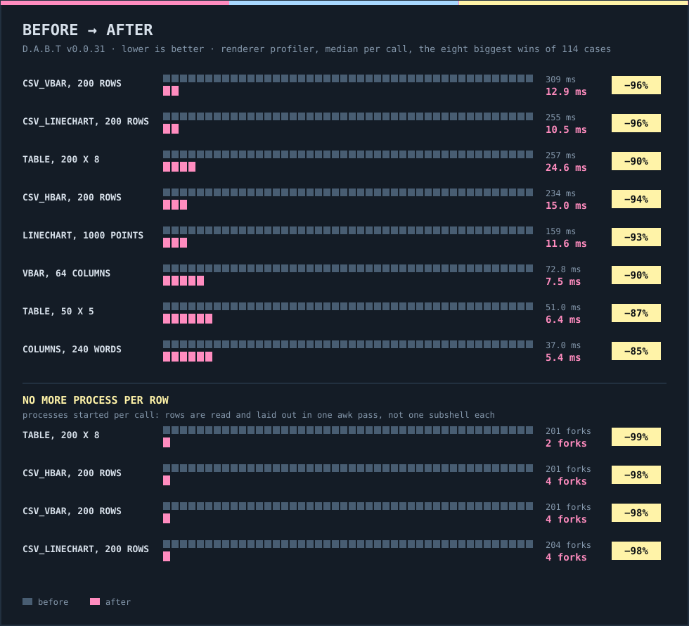
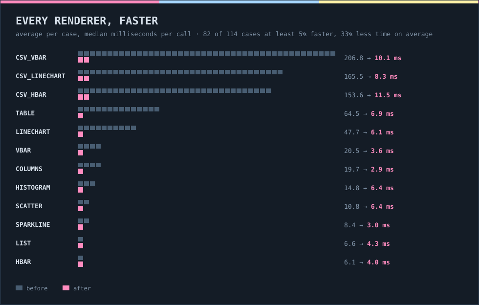

<div align="center">


<h1></h1>
</div>
<h3 align="center"><em>Measure it, then make it fast.</em></h3>

Version 0.0.30 gave you a profiler for pages. This release points a profiler at the renderers (`table`, `hbar`, `vbar`, `linechart`, the CSV charts and the rest of `lib/terminal_renderer.sh`) and then goes after what it found: **33% less time per call on average across 114 cases, 47% less in the 82 cases that got faster, and the big ones down by up to 96%.** A 200-row `csv_vbar` went from 309 ms to 13 ms, a 200 x 8 `table` from 257 ms to 25 ms, and none of them start a process per row any more.

Output did not change: every case prints the same bytes as before.





<h2></h2>

- **The renderers take 33% less time per call on average (x1.9 geometric mean over 114 profiler cases).**
- **82 of 114 cases are at least 5% faster, by 47% on average; the rest stay within a few percent.**
- **`csv_vbar` 207 to 10 ms, `csv_linechart` 165 to 8 ms and `csv_hbar` 154 to 12 ms per case on average.**
- **`table` 65 to 7 ms on average; 200 rows x 8 columns 257 to 25 ms.**
- **`linechart` 48 to 6 ms on average; 1000 points 159 to 12 ms.**
- **`vbar` 21 to 4 ms and `columns` 20 to 3 ms on average.**
- **`scatter` 42%, `histogram` 37%, `sparkline` 41%, `list` 30% and `hbar` 24% less time on average.**
- **No process per row or cell: a 200 row `table` or CSV chart forks 2 to 4 times, down from about 201.**
- **`box`, `alert`, `quote`, `divider`, `banner` and `badges` are unchanged within a few percent: they were already fast.**
- **The renderer profiler names every renderer correctly.** `vbar`, `linechart` and the CSV charts used to show up as "0", "10" and "12".
- **`tools/benchmarks/renderers/profile.sh` profiles every renderer of `lib/terminal_renderer.sh`** on several datasets and argument sets.

<h2></h2>

- `tools/benchmarks/renderers/profile.sh`: time per call, output size and forks for 114 renderer cases, a diff against the previous run, saved reports.
- `_tr_set_lines NAME STRING`: splits awk's output into an array without `mapfile`.
- `_tr_csv_entries NAME FILE DELIM HEADER`: reads the `label:value` pairs of a CSV in one awk pass.
- Release charts for this version: `tools/release_charts.py` entry `v0-0-31`.

<h2></h2>

- `table` (30 or more rows), `hbar` and `vbar` (40 or more entries), `linechart`, `sparkline` (over 300 points) and the CSV readers are laid out in one awk pass when the delimiter is one character. Smaller inputs and other delimiters keep the bash path, which is faster for them.
- `table` keeps each row's cells in an array of its own, trims only cells with an edge blank and skips the per-cell line table for single-line rows.
- `vbar` builds its cell, blank and underline strings once per chart instead of once per cell.
- `columns` keeps wrapped cells in arrays instead of `$(printf ...)` subshells and pads with slices of one blank run.
- `scatter` keeps each braille cell's dot mask while plotting; `histogram` splits a one-character delimiter inside awk.
- `_tr_wordwrap` returns early for one short line without escapes; `_tr_resample` reads its input through a nameref; `_tr_braille_init` builds its table with two `printf` calls.
- `columns` pads non-ASCII text by characters instead of bytes, so the columns line up.
- The benchmark tools live in `tools/benchmarks/`: `profiler/`, `compare-v2/` and `renderers/`.
- A `tui.every` job that is due at once no longer waits out the 50 ms poll; the profiler's nav tables show `shown` next to `done`, and `nav.arrows` measures a page switch by Enter on a focused menu button.

<h2></h2>

- Renderers no longer leak their loop variables into the caller: `vbar`, `table`, `kv`, `box`, `list`, `tree`, `hbar`, `csv_linechart` and `_tr_wordwrap` declare them `local`. The leak is what mislabelled the profiler's renderer groups.
- A page of a shell honours `autofocus`.
- Alt plus a digit or punctuation key no longer waits 10 ms for a sequence terminator.

<h2></h2>

```bash
dabt update                     # existing install
curl -fsSL https://raw.githubusercontent.com/DinosaursAreCute/DinosAmazingBashTui/main/install.sh | bash   # new install
```

The full list of changes is in the [changelog](https://github.com/DinosaursAreCute/DinosAmazingBashTui/blob/main/CHANGELOG.md). [Compare with v0.0.30](https://github.com/DinosaursAreCute/DinosAmazingBashTui/compare/v0.0.30...v0.0.31).
